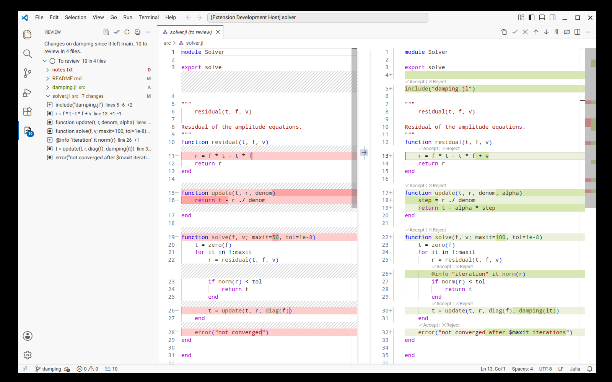
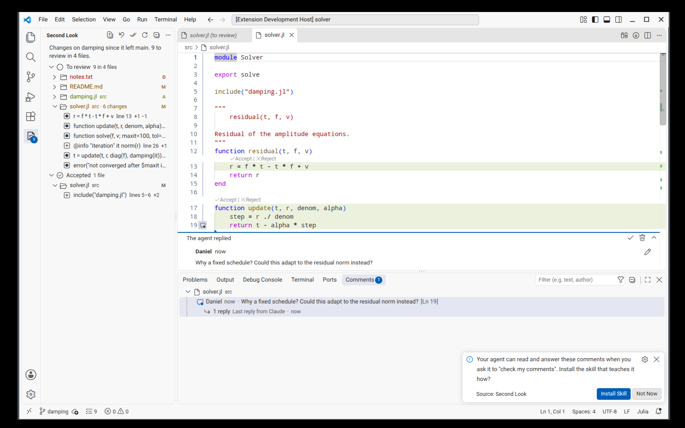

# Second Look

Review what a coding agent changed, one change at a time: accept it, reject
it, edit it, or leave a comment the agent reads later. When you are through,
finish the review; the next one shows only what changed since. You do not
stage, commit or pick branches for any of this.



## How it works

The Second Look icon in the activity bar opens the list of changes still to
review, file by file, with every change inside a file listed under it. The
line at the top says what the list covers, for example "Changes on damping
since it left main".

Click a file or a change to open it in a diff: on the left the text you have
accepted so far, on the right the file as it is now. For every change you can

- **accept** it: it counts as reviewed and leaves the list,
- **reject** it: the text you had accepted goes back into the file,
- **edit** the file: your own edits are changes like any other; accept them
  when they look right.

The buttons are on the rows of the list, as Accept and Reject links above each
change in the review diff and in the editor (below long changes too; other
diffs of the file, such as git's, compare something else and get none), and
on the keys Alt+Y (accept) and Alt+N (reject), which act on the change at the
cursor. The circled arrows at the front of the title bar, or Alt+F5 and
Shift+Alt+F5, go to the next and previous change to review, on into the next
file (VS Code's own next and previous change, which Second Look takes over in
review diffs and in files with changes to review); the line at the top of the
view lists these keys while there is something to review.
**Preferences: Keyboard Shortcuts**, searched for Second Look, changes them.
In the
ordinary editor the lines still to review are highlighted, with a dashed line
where text was removed; hovering them shows the text they replaced.

The first button on each row of the list, Open File, opens the change in the
file itself instead of the diff. The editor shows the file as it is, while a
side-by-side diff pads each side with empty space to keep both aligned. To
make that what a click does, set `secondLook.openIn` to `editor`: the next
change in another file then opens in the editor too, and the row button
becomes Open Diff. Deleted files always open in a diff.

In the diff, Second Look adds buttons next to the change under the cursor or
the mouse: Accept Block and Reject Block (Accept Selection when lines are
selected). VS Code puts its own Revert Block there too, an arrow (or under
`⋯` for short changes); that one is a plain edit of the file: Ctrl+Z in the
file takes it back, Second Look's Undo does not, and the agent is not told.
VS Code shows Second Look's buttons only once you allow them, because they
use an API that is still in preview: run
**Preferences: Configure Runtime Arguments**, add

```
"enable-proposed-api": ["dnkats.second-look"]
```

to the file that opens, and restart VS Code. With Remote-SSH this is the file
on your own computer, where the VS Code window runs. Once Accept Block is
there, Second Look leaves its Accept and Reject links out of review diffs: the
gutter has both, and each link line costs an empty line on the other side. The
editor keeps its links. Over Remote-SSH, VS Code does not tell the extension
that it allows the API, so the links go only after your first click on Accept
Block or Reject Block, and again after each VS Code update.

**Pause Review** in the view's `...` menu switches all this off in the window,
for when you open a checkout and do not want to review now: no highlights,
links, keys, arrows or counts, and the list is empty. **Resume Review** brings
it back as it was. Comments stay visible either way.

Accepted changes are listed under **Accepted**; **Review Again** puts one back
on the list. **Undo** in the view's title bar takes back the last accept or
reject, several steps deep, also after a restart.

New edits, by the agent or by you, show up in the list as they happen, and
commits change nothing about what you see: the review compares what you
accepted with the files as they are.

**Finish Review** (the double check mark) ends the review once nothing is
left. It can commit whatever is uncommitted as one "Review edits on
&lt;branch&gt;" commit or leave it as it is; it asks the first time. The next
review starts from what you finished with.



## Comments for the agent

Hover a line number and click `+`, or select lines first, to leave a comment.
If another extension offers comments on that line too, VS Code first shows a
menu; pick **Add comment for the agent (Second Look)**. Comments stay on their
lines when the file changes and say so when the code they were on is gone.
They are yours until you ask the agent to "check my comments": it then lists
them, with the code each one was written on, does what they say and answers in
the thread. It also learns which of its changes you rejected, so it does not
put them back. You resolve threads when you are satisfied.

The agent learns this from a skill that ships with the extension. Install it
once with **Second Look: Install Agent Skill…**; it goes to `~/.claude/skills`
(Claude Code) and `~/.agents/skills` (Codex, GitHub Copilot and other agents
that read Agent Skills), on the machine where the extension runs. VS Code's own
chat gets it automatically. The skill's command is
`review-comments list | reply <id> <text>`; it needs Node.js, and uses the one
that runs VS Code when there is none on the PATH. For an agent without skills,
**Copy Open Comments as Prompt** puts them on the clipboard.

## What a review covers

Nothing needs to be chosen by hand. For the branch you are on, the review
covers:

- after a finished review: everything since then;
- the first time on a side branch: everything since it left main (or master);
- the first time on main: the commits not pushed yet, if main has an upstream,
  otherwise everything from the moment the review started;

and always the uncommitted changes. **Review From…** in the view's menu starts
over from any commit instead. When you rebase a side branch onto a newer main,
or merge main into it, the review moves along: what came from main does not
show up for review, and what you accepted stays accepted. A file where main's
changes conflict with the review is shown for review again.

On main itself the review does not follow origin. Pushing changes nothing:
commits you have not reviewed stay on the list after the push. Pulling puts
everything the pull brought on the list, since to the review it is new on
main like the agent's commits. When you pull on main and do not want to read
what others merged, review your own changes first, pull, then choose **Review
From…** → **From now on**: the review starts at the pulled commit and still
covers your uncommitted changes. What you had accepted is dropped, which is
why your own changes come first.

Each branch has its own review. Switch branches, come back, and it is as you
left it.

## Install

The extension runs where your files are: locally, or on the remote machine in
a Remote-SSH, WSL or dev-container window. Install the `.vsix` from the
Extensions view's `…` menu (Install from VSIX), or in the window's terminal:

```
code --install-extension second-look-0.1.14.vsix
```

Requirements: VS Code 1.90 or newer and git on the PATH (or in `git.path`).
Moving a review along a rebase needs git 2.40 or newer; with an older git,
main's changes show up for review after a rebase.

## Where the state lives

Everything is inside the checkout's git directory and never touches git's own
index, the staging area:

- `.git/second-look/<branch>.json`, `.index` and `.undo.json`: the review in
  progress (the index file holds what you accepted),
- `.git/second-look/comments.json`: the comments,
- `refs/second-look/<branch>`: keeps the accepted content safe from
  `git gc`,
- `refs/reviewed/<branch>`: where the last finished review ended.

Delete those and the extension has never been there.

## With the git-review command line tool

This extension grew out of [git-review](https://github.com/dnkats/git-review),
which uses git's index as the checklist. Both record a finished review in
`refs/reviewed/<branch>`, so either one continues where the other finished.
When a terminal review is open in the checkout, the view offers to take it
over: what you accepted there stays accepted, and git's index goes back to
normal.

## Limitations

- If the agent works in its own worktree or clone, open that folder to review
  it.
- VS Code's Source Control view keeps showing git's own changes (uncommitted
  against HEAD). They differ from the review list whenever the agent has
  committed.
- To show its Accept and Reject links in diffs, Second Look turns VS Code's
  `diffEditor.codeLens` on by default. Links of other extensions then show in
  diffs too, Julia's Run, Above, Below and Debug above each cell for example.
  **Hide CodeLens Links in Diffs** in the Second Look view's `...` menu turns
  them all off (it sets `diffEditor.codeLens` to `false`); Show turns them
  back on.
- Accept Block and Reject Block use a proposed VS Code API: they need the
  runtime argument above, and an extension using it cannot be published on
  the Marketplace as it is.
- An editor's title bar shows about seven buttons and moves the rest under
  `...`, the later ones first; which ones depends on what all extensions add
  for that file. Second Look's arrows come first, VS Code's own diff arrows
  late, so those can end up there. Right-click a button you don't need and
  hide it to make room.
- After a diff has switched to the one-column view on a narrow editor, its left
  side no longer wraps lines (VS Code issue
  [#314898](https://github.com/microsoft/vscode/issues/314898)); Alt+Z twice
  wraps it again, and `"diffEditor.useInlineViewWhenSpaceIsLimited": false`
  avoids the switch.
- After every accept VS Code computes the whole diff of the file anew, and its
  default diff algorithm takes seconds for files with many changes, in git's
  diffs too. With `"diffEditor.diffAlgorithm": "legacy"` the same diff is
  redrawn several times faster: for a file of 1,000 lines with 116 changes the
  accepted block showed after 0.5 s instead of 3.7 s.
- Binary files, renames (a deletion plus a new file), submodules and changes of
  the file mode are accepted or rejected as whole files.
- One person reviews a checkout at a time.

## Settings

- `secondLook.finish.commitEdits`: `ask`, `always` or `never` commit
  uncommitted changes when finishing.
- `secondLook.codeLens`, `secondLook.highlightChanges`, `secondLook.statusBar`:
  turn the links, the line highlights and the status bar count off.
- `secondLook.codeLensBelow`: changes of at least this many lines (10) get
  the Accept and Reject links below them too; 0 turns that off.
- `secondLook.openIn`: `diff` (the default) or `editor`, where a click in the
  list opens a change.

## Development

```
npm install
npm test               # engine and comment tests on scratch repositories
npm run test:vscode    # the extension in a real VS Code, headless via Xvfb
npm run package        # builds second-look-<version>.vsix
node test/vscode/demo.mjs shots   # screenshots of the UI
```

Both VS Code runs use `/usr/share/code/code` unless `VSCODE_PATH` names
another VS Code; the screenshot script also reads `GRV_SCREEN` (screen size)
and `GRV_SETTINGS` (extra settings as JSON).

The engine (`src/engine`) and the comment store (`src/comments/store.ts`) do
not depend on VS Code; the agent's command (`src/cli`) is built into the
skill folder.
